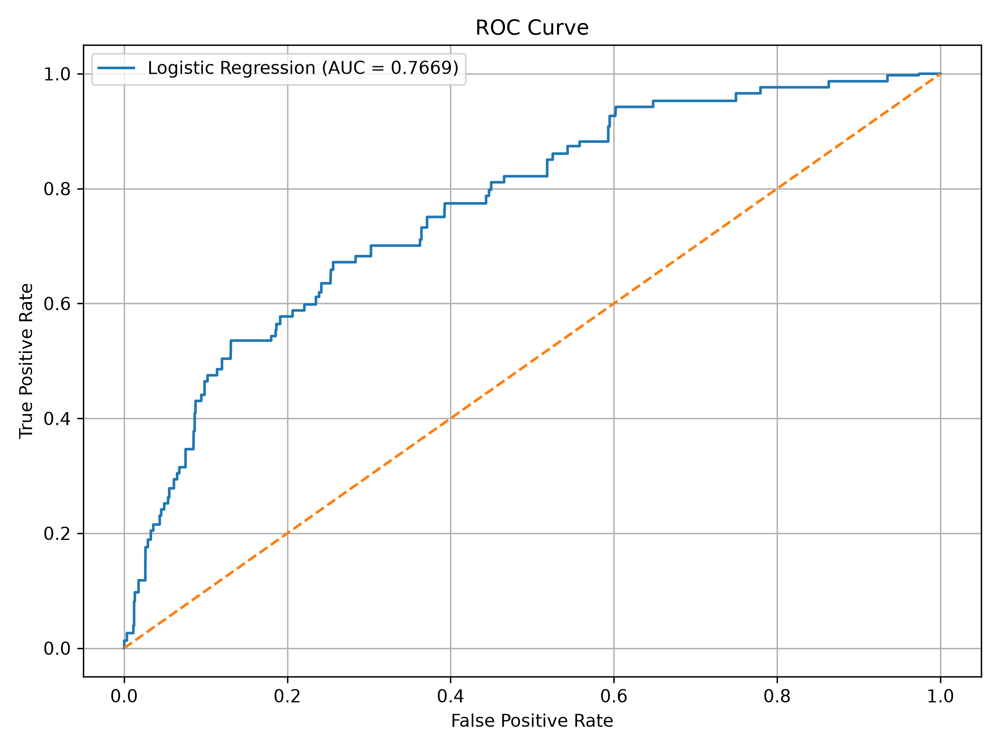
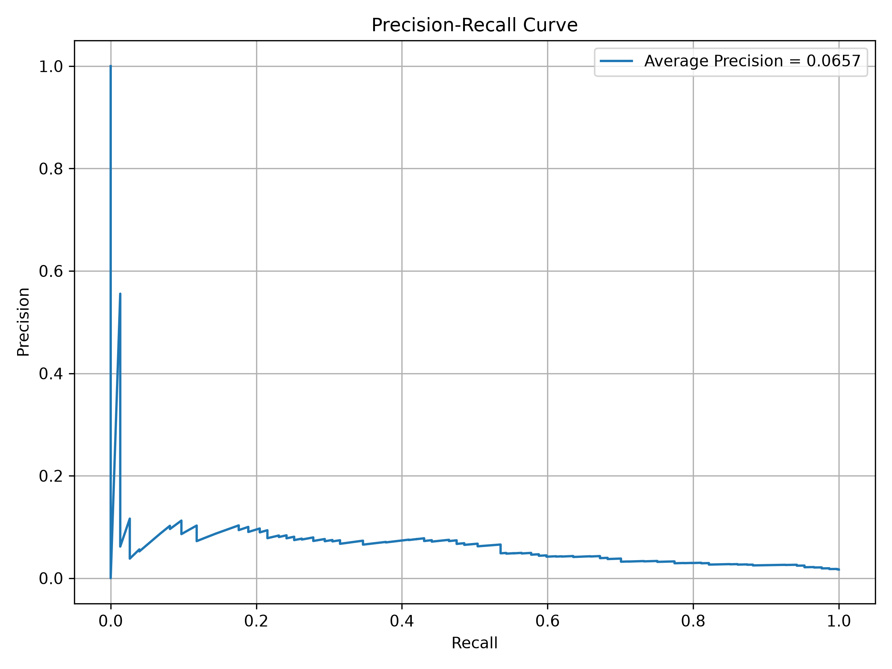
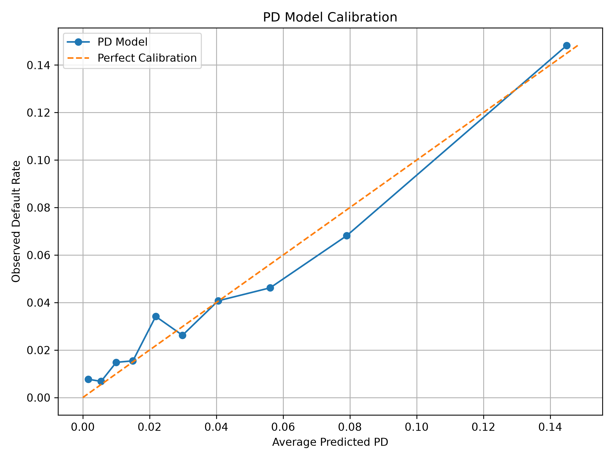
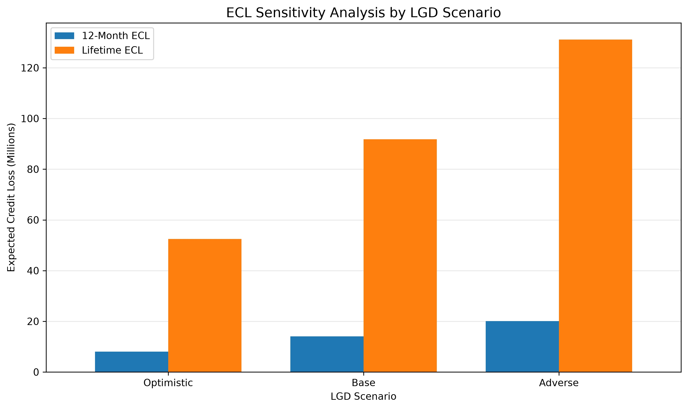
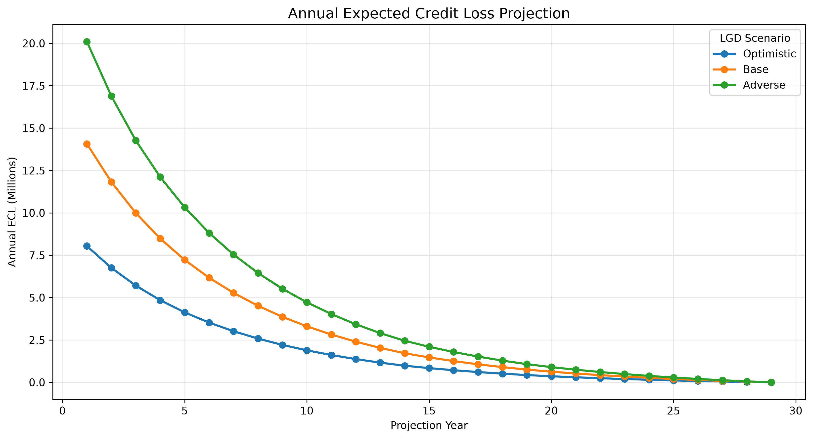

# Credit Risk Modeling and Expected Credit Loss (ECL) Framework

## Project Overview

This project presents an end-to-end credit risk modeling workflow developed in Python, covering exploratory data analysis, data quality assessment, Probability of Default (PD) modeling, model validation, portfolio risk analysis, Exposure at Default (EAD), Lifetime PD projection and Expected Credit Loss (ECL) estimation.

The project evolved through two complementary analytical phases, using two different mortgage-related datasets:

1. Loan Default Analysis: Exploratory credit risk analysis, data quality assessment, Weight of Evidence (WOE) and Information Value (IV) analysis, and logistic regression PD modeling.
2. Freddie Mac Mortgage Portfolio: Development of a more comprehensive loan-level PD, EAD, Lifetime PD and scenario-based ECL framework.

The objective was to explore credit risk drivers, develop interpretable default prediction models, evaluate model performance and demonstrate how loan-level risk estimates can be incorporated into a portfolio-level expected credit loss framework.

The project was developed using Python, with an emphasis on reproducibility, model interpretability, data quality, validation and transparent modeling assumptions.

## ---

## PART I – LOAN DEFAULT ANALYSIS AND PD MODELING

### 1. Dataset and Exploratory Data Analysis

The first phase used the "Loan_Default.csv" dataset, containing approximately 148,670 observations and 34 explanatory variables.

The initial analysis focused on understanding the portfolio, identifying potential credit risk drivers and assessing the quality and suitability of the available data for PD modeling.

The exploratory analysis included:

- Default and non-default distribution analysis.
- Default rates across borrower and loan characteristics.
- Credit score segmentation.
- Loan-to-Value (LTV) analysis.
- Debt-to-Income (DTI/DTIR) analysis.
- Income and property value analysis.
- Loan purpose and loan type analysis.
- Missing-value and outlier assessment.
- Identification of potential data inconsistencies.

Selected Exploratory Findings

Several findings highlighted the importance of data quality and feature assessment before model development.

Credit Score

Default rates across credit score groups were relatively similar, despite the expected negative relationship between creditworthiness and default risk.

Average credit scores were approximately:

- Non-default observations: 699.52
- Default observations: 700.60

This suggested that the available credit score variable had limited discriminatory power in the initial dataset.

LTV and Property Value

Anomalous LTV values were identified, including an extreme value of 7,831.25, associated with unusually low property values.

Missing LTV and property value information was also highly concentrated in default observations:

- Missing LTV/property value among defaults: approximately 41.20%.
- Missing LTV/property value among non-defaults: approximately 0.002%.

DTI

Missing DTIR information was also unevenly distributed:

- Defaults: approximately 44.52%.
- Non-defaults: approximately 6.97%.

These differences indicated that missingness itself required careful consideration and could not automatically be treated as random.

Credit Type

The "EQUI" credit type displayed an extreme default concentration, with 15,297 defaults among 15,298 observations.

This was treated as a potential data-quality anomaly rather than accepted as a reliable general credit risk relationship.

### 2. Data Cleaning and Feature Assessment

The initial dataset was reviewed and cleaned before model development.

The "EQUI" category was excluded due to its anomalous default concentration.

Seventeen observations with LTV values above 200% were removed during the subsequent data-cleaning process.

The resulting modeling dataset contained:

- 133,372 observations.
- 34 original explanatory variables.
- No remaining missing values in the final modeling dataset.

A stratified train/test split was applied:

Dataset| Observations
Training| 93,348
Testing| 40,007

The default rate was approximately 16.00% in the training dataset and 15.99% in the test dataset.

### 3. Weight of Evidence (WOE) and Information Value (IV)

WOE and IV analysis was conducted to assess the discriminatory information contained in individual variables and support interpretable credit risk modeling.

Selected Information Value results:

Variable| Information Value
Income| 0.159492
Submission of Application| 0.135931
Negative Amortization| 0.131071
DTIR| 0.129600
Property Value| 0.091264
Loan Type| 0.074716
LTV| 0.073921
Credit Score| 0.000714

The results indicated that income, application characteristics, negative amortization and debt-to-income information contained more discriminatory information than the available credit score variable in this particular dataset.

The very low IV of Credit Score was consistent with the earlier exploratory findings.

### 4. WOE Logistic Regression – PD Model

An interpretable logistic regression model was developed using WOE-transformed explanatory variables.

The model included borrower, loan and property characteristics, including:

- DTIR
- LTV
- Income
- Property value
- Loan amount
- Credit score
- Negative amortization
- Loan type
- Loan purpose
- Credit worthiness
- Business or commercial indicator
- Loan limit
- Age
- Submission of application
- Region

The model development process included:

- WOE feature transformation.
- Logistic regression estimation.
- Train/test performance assessment.
- Coefficient and odds-ratio analysis.
- Predicted probability generation.
- Calibration and risk decile analysis.

Model Performance

Metric| Training| Testing
ROC-AUC| 0.7113| 0.7024
GINI| 0.4226| 0.4049

Additional validation results:

Metric| Result
KS statistic| 0.2972
Brier Score| 0.1240
Default Recall at evaluated threshold| 5%

The model showed a moderate ability to rank default risk, with relatively stable ROC-AUC between training and testing datasets.

However, the low default recall at the evaluated classification threshold highlighted the limitations of relying on a single classification threshold, particularly when identifying relatively rare or high-risk observations.

Selected Model Relationships

The odds-ratio analysis indicated several important relationships:

Variable| Odds Ratio
Loan Type| 18.64
Loan Amount| 1.84
Credit Score| 0.15
LTV| 0.34

These results illustrate the direction and relative magnitude of selected modeled relationships, conditional on the model specification and variable encoding.

Calibration and Risk Segmentation

The model was also assessed through predicted-versus-observed default rates across risk deciles.

The highest-risk decile showed:

- Predicted default rate: 41.19%.
- Observed default rate: 38.37%.

The analysis provided an additional perspective on the model's ability to differentiate risk segments beyond aggregate discrimination metrics.

---

## PART II – FREDDIE MAC MORTGAGE PORTFOLIO MODELING

### 5. Dataset and Portfolio Construction

The second phase used Freddie Mac sample mortgage loan-level data, combining loan origination characteristics with monthly loan performance information.

The modeling dataset contained:

- 113,325 monthly observations.
- 7,563 unique loans.
- 2,096 positive 12-month default target observations.
- An observed target default rate of approximately 1.85%.

The performance dataset contained 223,833 observations and 9,572 unique loans.

Data preparation included:

- Loan-level identification and monthly observation alignment.
- Missing-value assessment.
- Feature engineering.
- Construction of a 12-month default target.
- Origination characteristic preparation.
- Portfolio snapshot extraction.
- Loan-level and portfolio-level reconciliation.

The September 2021 portfolio snapshot was selected for the final portfolio analysis.

### 6. Probability of Default (PD) Modeling

Model Specification

A logistic regression model was developed to estimate 12-month PD.

Numerical features

- FICO score
- Loan-to-Value ratio (LTV)
- Combined Loan-to-Value ratio (CLTV)
- Debt-to-Income ratio (DTI)
- Original unpaid principal balance
- Original interest rate
- Original loan term
- Number of borrowers
- Number of property units
- Mortgage insurance percentage

Categorical features

- First-time homebuyer indicator
- Occupancy status
- Origination channel
- State
- Property type
- Loan purpose

Preprocessing

The model pipeline included:

- Median imputation for numerical variables.
- Standardization of numerical variables.
- Most-frequent imputation for categorical variables.
- One-hot encoding of categorical variables.
- Logistic regression with a maximum of 2,000 iterations.

Training observations were weighted so that each loan contributed an equal total weight, reducing the influence of loans with more monthly observations.

Model Validation

A group-based train/test split was implemented using "GroupShuffleSplit" and loan identifiers ("id_loan").

This ensured that individual loans did not appear in both training and testing datasets.

Dataset| Observations| Unique Loans
Training| 90,773| 6,050
Testing| 22,552| 1,513

Observation-weighted validation metrics

Metric| Result
ROC-AUC| 0.7669
GINI| 0.5338
Average Precision| 0.0657
Brier Score| 0.0174
Log Loss| 0.0870

Loan-weighted validation metrics

Metric| Result
ROC-AUC| 0.7481
GINI| 0.4961
Average Precision| 0.1310
Brier Score| 0.0403
Log Loss| 0.1637

Observation-weighted and loan-weighted metrics represent different evaluation perspectives and should not be directly compared as equivalent estimands.

The validation split is random group-held-out validation, not time-based out-of-time validation.

PD Model Visualizations

ROC Curve

Precision–Recall Curve

PD Calibration

The ROC curve evaluates the model's ability to rank default and non-default observations.

The precision–recall curve provides an additional perspective given the relatively low default frequency.

The calibration plot compares predicted and observed default frequencies across risk groups.

### 7. Portfolio PD Estimation

The final logistic regression pipeline was fitted on the complete modeling dataset and used to estimate 12-month PD for the September 2021 portfolio.

The portfolio snapshot contains 4,729 loans, with all records successfully matched to the corresponding performance data.

Metric| Result
Number of loans| 4,729
Total outstanding balance| 887.83 million
Average 12-month PD| 3.66%
EAD-weighted average PD| 4.67%
Minimum PD| 0.0042%
Maximum PD| 36.45%

Portfolio PD estimates are in-sample scores because the final model was refitted using the complete modeling dataset. They should not be interpreted as independent out-of-sample portfolio predictions.

### 8. Exposure at Default (EAD)

Current actual unpaid principal balance ("curr_act_upb") was used as a proxy for exposure at default.

The September 2021 portfolio exposure is summarized below:

Metric| Result
Total EAD| 887.83 million
Average EAD per loan| 187,740.94
Median EAD| 165,803.95
Minimum EAD| 6,089.21
Maximum EAD| 793,905.40
PD-weighted EAD| 41.43 million

The portfolio's exposure is concentrated in loans with longer remaining maturities.

Current outstanding principal is used as an EAD proxy rather than an independently estimated exposure-at-default model.

### 9. LGD Data Assessment and Scenario Assumptions

A review of the available performance data was conducted to identify realized loss events and assess the availability of recovery information.

The available sample did not contain the relevant mortgage liquidation/loss-event codes required to estimate realized LGD from observed loss events.

Consequently, an empirical LGD model could not be reliably calibrated from the available data.

Three transparent LGD assumptions were therefore applied:

Scenario| LGD
Optimistic| 20%
Base| 35%
Adverse| 50%

These values are illustrative scenario assumptions and are not empirically estimated portfolio LGDs.

Missing recovery information was not treated as zero recovery.

### 10. Lifetime Probability of Default

Lifetime PD was projected from estimated 12-month PD using a constant hazard-rate assumption.

The cumulative lifetime PD is calculated as:

$$
PD_{lifetime}=1-(1-PD_{12m})^{T/12}
$$

Where:

- (PD_{12m}) is the estimated 12-month probability of default.
- (T) is the remaining contractual maturity in months.

The method assumes a constant conditional default hazard over the remaining life of each loan.

Portfolio Results

Metric| Result
Average 12-month PD| 3.66%
EAD-weighted 12-month PD| 4.67%
Average lifetime PD| 45.13%
EAD-weighted lifetime PD| 52.58%
Maximum remaining maturity| 348 months

Annual marginal PDs were reconciled against cumulative lifetime PDs, with a maximum absolute reconciliation difference of approximately (1.11 \times 10^{-16}).

Lifetime PD Projection

"Lifetime PD Projection" (README_images/lifetime_pd_projection.png)

The chart presents the EAD-weighted cumulative lifetime PD across the projection horizon.

Lifetime PD is a constant-hazard extrapolation of estimated 12-month PD, rather than an independently calibrated lifetime PD model.

### 11. Expected Credit Loss (ECL) Calculation

Expected Credit Loss is calculated by integrating marginal default probability, projected exposure and LGD assumptions over the relevant time horizon.

The general conceptual relationship is:

$$
ECL=\sum_{t=1}^{T}MarginalPD_t \times EAD_t \times LGD \times DF_t
$$

Where:

- (MarginalPD_t) is the marginal probability of default in period (t).
- (EAD_t) is the projected exposure at default.
- (LGD) is the assumed loss given default.
- (DF_t) is the discount factor.

Main Modeling Assumptions

Default probability

Monthly default probabilities are derived from estimated 12-month PD using an implied constant monthly hazard rate.

Exposure projection

A simplified fully amortizing mortgage schedule is used to project future exposure, based on original interest rates and remaining contractual maturity.

Discounting

The original contractual interest rate is used as a proxy discount rate.

The discount factor is calculated using a mid-month convention:

$$
DF_t=(1+r)^{-(t-0.5)/12}
$$

Where (r) represents the annual rate proxy and (t) is the month of projection.

The original interest rate is not confirmed to be the effective interest rate (EIR).

Time horizons

- 12-month ECL includes the first 12 months of discounted expected losses.
- Lifetime ECL includes expected losses over the remaining projected maturity.

ECL Scenario Results

LGD Scenario| LGD Assumption| 12-Month ECL| Lifetime ECL
Optimistic| 20%| 8.04 million| 52.44 million
Base| 35%| 14.07 million| 91.77 million
Adverse| 50%| 20.10 million| 131.10 million

Amounts are expressed in the original currency of the source dataset. Currency denomination has not been independently verified.

ECL Scenario Analysis

The chart compares 12-month and lifetime ECL under the three LGD assumptions.

Annual ECL Profile

The annual ECL profile illustrates the projected distribution of expected credit losses over the remaining portfolio horizon.

The three lines represent alternative LGD scenarios and are not additive.

### 12. Model Validation and Reconciliation

Several consistency checks were incorporated into the modeling workflow:

- No overlap of loan identifiers between PD training and testing datasets.
- Validation of portfolio loan counts and successful performance-data matching.
- Reconciliation of annual marginal PDs with cumulative lifetime PDs.
- Confirmation that 12-month ECL does not exceed lifetime ECL.
- Confirmation of the expected ordering of ECL across LGD scenarios.
- Consistency checks across loan-level and portfolio-level calculations.

These checks support the internal consistency of the implemented calculations, but do not replace independent model validation or benchmarking against realized losses.

### ---

## Technology Stack

- Python
- pandas
- NumPy
- scikit-learn
- Matplotlib
- Joblib

## Project Structure

Credit Risk Modeling/
│
├── data_raw/
│ ├── Loan_Default.csv
│ └── freddie_mac_sample/
│
├── outputs/
│ ├── data_preparation/
│ ├── default_analysis/
│ ├── logistic_regression/
│ ├── pd_model/
│ ├── pd_validation/
│ ├── ead/
│ ├── lgd/
│ ├── lifetime_pd/
│ └── ecl/
│
├── README_images/
│ ├── pd_roc_curve.png
│ ├── pd_precision_recall.png
│ ├── pd_calibration.png
│ ├── lifetime_pd_projection.png
│ ├── ecl_scenario_analysis.png
│ └── annual_ecl_profile.png
│
├── scripts/
│ └── Python analysis and modeling scripts
│
└── README.md

The structure above summarizes the main project components. Individual output folders and script locations may differ in the working environment.

Limitations and Further Development

This project is a demonstrative credit risk modeling framework and should not be interpreted as a production-ready or fully IFRS 9-compliant ECL system.

The main limitations are:

1. Dataset limitations: The two datasets have different structures and purposes. The initial Loan Default dataset supports exploratory analysis and PD modeling, while the Freddie Mac dataset is used for the portfolio ECL workflow.
2. LGD estimation: Realized loss events required for empirical LGD calibration were not available in the analyzed Freddie Mac sample. LGD is therefore represented by illustrative scenarios.
3. Lifetime PD: Lifetime PD is derived using a constant hazard-rate assumption rather than a separately calibrated lifetime model.
4. EAD estimation: Current outstanding principal is used as an EAD proxy, while future exposure is projected using a simplified amortization schedule.
5. Discount rate: Original contractual interest rates are used as proxies and have not been verified as effective interest rates.
6. Macroeconomic scenarios: The ECL framework does not incorporate forward-looking macroeconomic forecasts or probability-weighted economic scenarios.
7. IFRS 9 staging: The project does not implement full Stage 1, Stage 2 and Stage 3 classification, Significant Increase in Credit Risk (SICR) assessment or the associated staging methodology.
8. Validation: The Freddie Mac PD model uses group-held-out random validation rather than time-based out-of-time validation. Portfolio PD estimates are in-sample.

Potential further development includes:

- Empirical LGD modeling using a dataset containing realized liquidation and recovery events.
- More advanced EAD modeling.
- Macroeconomic scenario integration and forward-looking adjustments.
- Time-based out-of-time model validation.
- PD calibration and stability analysis across economic periods.
- IFRS 9 staging and SICR assessment.
- Independent benchmarking against realized portfolio losses.

## Disclaimer

This project was developed for educational, analytical and portfolio demonstration purposes.

The assumptions and results are based on the available sample datasets and the modeling methodologies described above. They should not be interpreted as official regulatory, accounting or production credit risk estimates.

Raw datasets are not included in this repository. Users should obtain the source data independently and comply with applicable data access, licensing and redistribution terms.
